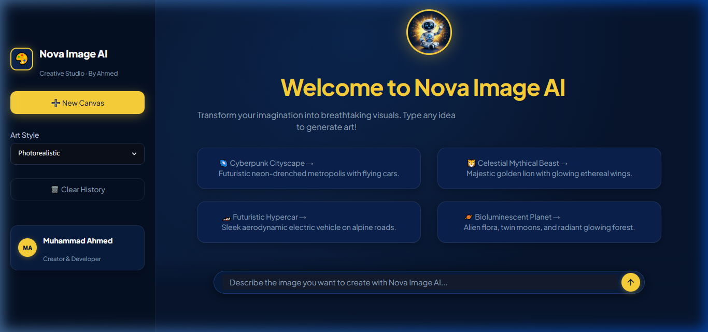

# 🎨 Nova Image AI - Creative Studio

A modern, high-aesthetic AI Image Generation application built with **Python & Streamlit**, powered by **Azure OpenAI (`gpt-4o`)** and high-fidelity rendering engines.



---

## ✨ Features
- 🎨 **Dark Navy (`#07152E`) & Accent Yellow (`#FFD43B`) Modern Aesthetic**.
- 🤖 **3D Robot Mascot Hero Banner** with glowing halo.
- 💡 **4 Quick Creative Inspiration Cards** (Cyberpunk Cityscape, Celestial Beast, Hypercar, Alien Planet).
- 🎭 **Art Style Customizer**: Photorealistic, Cinematic, Digital Art, Cyberpunk, Anime, 3D Render.
- 🧠 **Dynamic Prompt Enhancement**: Refines prompts using Azure OpenAI (`gpt-4o`).
- 📥 **Direct PNG Download Button**: Download generated artwork with a single click.

---

## 🚀 Quick Start

### 1. Install Dependencies
```bash
pip install -r requirements.txt
```

### 2. Run the Application
Double-click `run.bat` or run:
```bash
streamlit run app.py --server.port 8506
```

The application will open at:
```
http://localhost:8506
```

